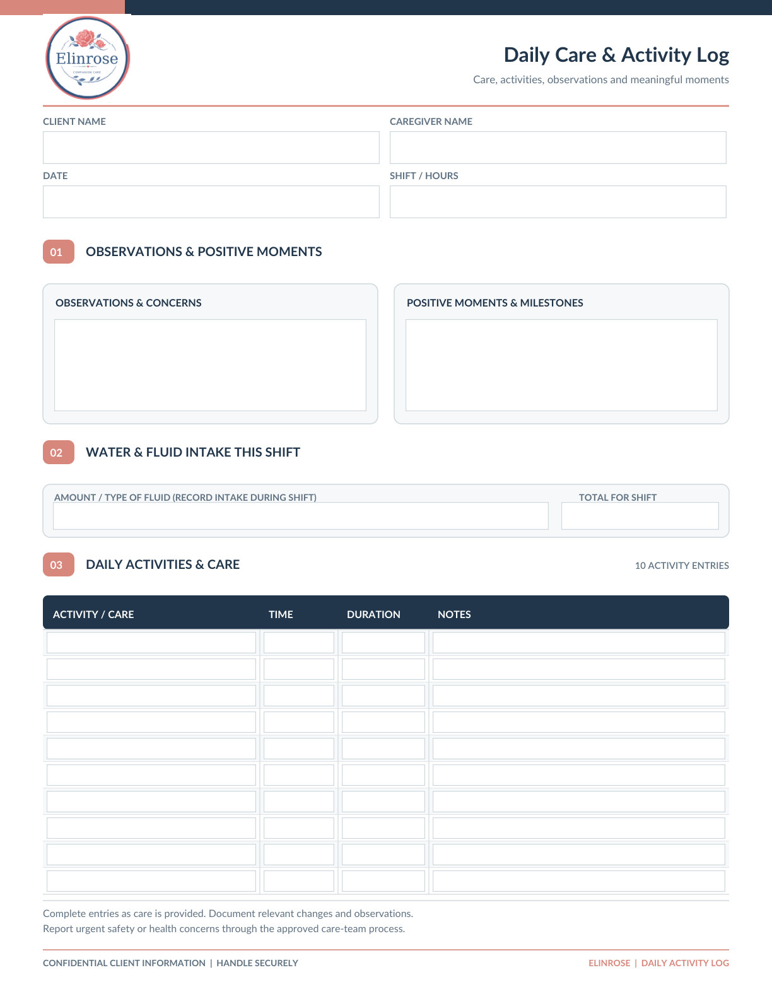
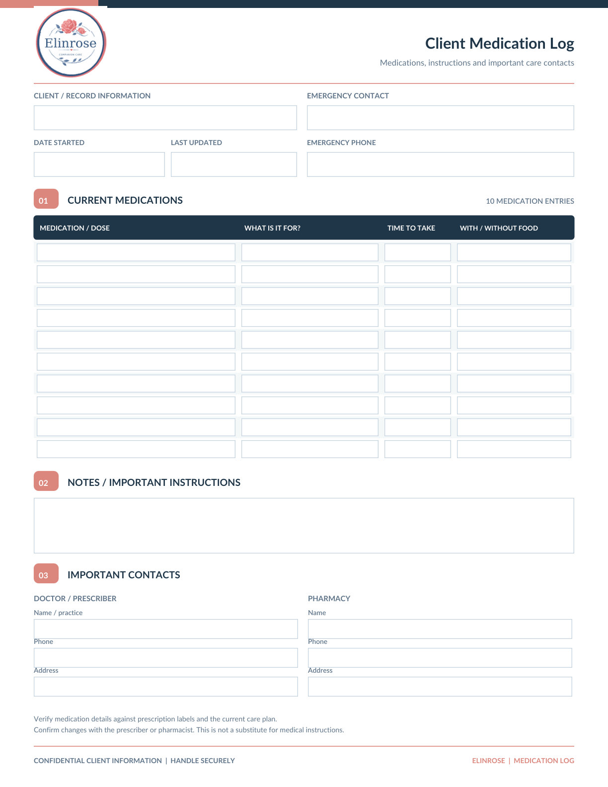
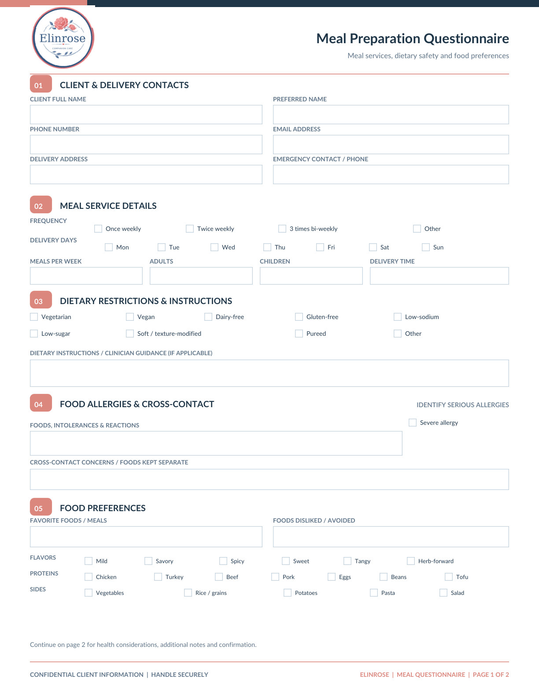
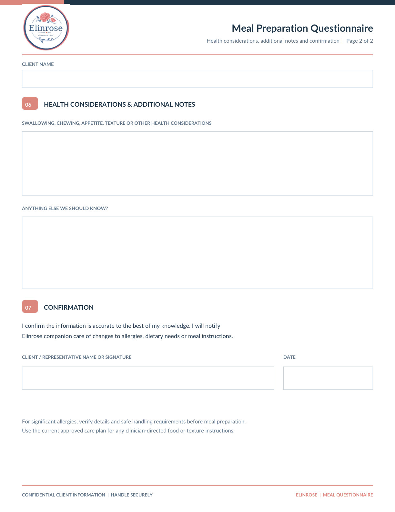

# Elinrose companion care — PDF-independent visual and field reference

**For Fancy:** This page is deliberately readable without a PDF viewer or Google Drive connection. All screenshots are exact rendered images of the original blank PDFs, not regenerated form designs. This guide is public; never place real client records here.

**Source:** `Elinrose_All_Care_Forms_Fillable.pdf` (4 US Letter pages, 159 blank interactive form fields).

**Machine-readable exact PDF widget map:** [FORM_FIELDS.json](https://raw.githubusercontent.com/IPXSdev/xa-vault/main/brands/elinrose-companion-care/FORM_FIELDS.json) — includes each field name, field type, page, and rectangular placement coordinates.

## All four page previews

### Page 1: Daily Care & Activity Log



[Open page 1 directly as an image](https://raw.githubusercontent.com/IPXSdev/xa-vault/main/brands/elinrose-companion-care/Elinrose_Form_Preview_Page_01.jpg)

#### Sections and layout

- Client and caregiver identification; date and shift/hours
- 01 Observations & Positive Moments: observations and concerns; positive moments and milestones
- 02 Water & Fluid Intake This Shift: fluid intake details; total for shift
- 03 Daily Activities & Care: ten rows of activity/care, time, duration and notes
- Footer: confidential client information / handle securely

#### Exact PDF form field names (48 fields)

| Field name | Control type |
| --- | --- |
| `client_name` | Text |
| `caregiver_name` | Text |
| `date` | Text |
| `shift_hours` | Text |
| `observations_and_concerns` | Text |
| `positive_moments_and_milestones` | Text |
| `fluid_intake_details` | Text |
| `total_fluids` | Text |
| `activity_01` | Text |
| `time_01` | Text |
| `duration_01` | Text |
| `notes_01` | Text |
| `activity_02` | Text |
| `time_02` | Text |
| `duration_02` | Text |
| `notes_02` | Text |
| `activity_03` | Text |
| `time_03` | Text |
| `duration_03` | Text |
| `notes_03` | Text |
| `activity_04` | Text |
| `time_04` | Text |
| `duration_04` | Text |
| `notes_04` | Text |
| `activity_05` | Text |
| `time_05` | Text |
| `duration_05` | Text |
| `notes_05` | Text |
| `activity_06` | Text |
| `time_06` | Text |
| `duration_06` | Text |
| `notes_06` | Text |
| `activity_07` | Text |
| `time_07` | Text |
| `duration_07` | Text |
| `notes_07` | Text |
| `activity_08` | Text |
| `time_08` | Text |
| `duration_08` | Text |
| `notes_08` | Text |
| `activity_09` | Text |
| `time_09` | Text |
| `duration_09` | Text |
| `notes_09` | Text |
| `activity_10` | Text |
| `time_10` | Text |
| `duration_10` | Text |
| `notes_10` | Text |

#### Exact page text (reading order from PDF extractor)

```text
Daily Care & Activity Log
Care, activities, observations and meaningful moments
CLIENT NAME
CAREGIVER NAME
DATE
SHIFT / HOURS
01
OBSERVATIONS & POSITIVE MOMENTS
OBSERVATIONS & CONCERNS
POSITIVE MOMENTS & MILESTONES
02
WATER & FLUID INTAKE THIS SHIFT
AMOUNT / TYPE OF FLUID (RECORD INTAKE DURING SHIFT)
TOTAL FOR SHIFT
03
DAILY ACTIVITIES & CARE
10 ACTIVITY ENTRIES
ACTIVITY / CARE
TIME
DURATION
NOTES
Complete entries as care is provided. Document relevant changes and observations.
Report urgent safety or health concerns through the approved care-team process.
CONFIDENTIAL CLIENT INFORMATION  |  HANDLE SECURELY
ELINROSE  |  DAILY ACTIVITY LOG
```

### Page 2: Client Medication Log



[Open page 2 directly as an image](https://raw.githubusercontent.com/IPXSdev/xa-vault/main/brands/elinrose-companion-care/Elinrose_Form_Preview_Page_02.jpg)

#### Sections and layout

- Client/record information, date started and last updated; emergency contact and emergency phone
- 01 Current Medications: ten rows of medication/dose, what it is for, time to take, with/without food
- 02 Notes / Important Instructions
- 03 Important Contacts: doctor/prescriber and pharmacy, each with name, phone and address
- Footer: verify against prescription labels and care plan; not a substitute for medical instructions

#### Exact PDF form field names (52 fields)

| Field name | Control type |
| --- | --- |
| `med_client_name` | Text |
| `med_emergency_name_relationship` | Text |
| `med_date_started` | Text |
| `med_last_updated` | Text |
| `med_emergency_phone` | Text |
| `med_row_1_1` | Text |
| `med_row_1_2` | Text |
| `med_row_1_3` | Text |
| `med_row_1_4` | Text |
| `med_row_2_1` | Text |
| `med_row_2_2` | Text |
| `med_row_2_3` | Text |
| `med_row_2_4` | Text |
| `med_row_3_1` | Text |
| `med_row_3_2` | Text |
| `med_row_3_3` | Text |
| `med_row_3_4` | Text |
| `med_row_4_1` | Text |
| `med_row_4_2` | Text |
| `med_row_4_3` | Text |
| `med_row_4_4` | Text |
| `med_row_5_1` | Text |
| `med_row_5_2` | Text |
| `med_row_5_3` | Text |
| `med_row_5_4` | Text |
| `med_row_6_1` | Text |
| `med_row_6_2` | Text |
| `med_row_6_3` | Text |
| `med_row_6_4` | Text |
| `med_row_7_1` | Text |
| `med_row_7_2` | Text |
| `med_row_7_3` | Text |
| `med_row_7_4` | Text |
| `med_row_8_1` | Text |
| `med_row_8_2` | Text |
| `med_row_8_3` | Text |
| `med_row_8_4` | Text |
| `med_row_9_1` | Text |
| `med_row_9_2` | Text |
| `med_row_9_3` | Text |
| `med_row_9_4` | Text |
| `med_row_10_1` | Text |
| `med_row_10_2` | Text |
| `med_row_10_3` | Text |
| `med_row_10_4` | Text |
| `med_instructions` | Text |
| `med_doctor_name_practice` | Text |
| `med_pharmacy_name_practice` | Text |
| `med_doctor_phone` | Text |
| `med_pharmacy_phone` | Text |
| `med_doctor_address` | Text |
| `med_pharmacy_address` | Text |

#### Exact page text (reading order from PDF extractor)

```text
Client Medication Log
Medications, instructions and important care contacts
CLIENT / RECORD INFORMATION
EMERGENCY CONTACT
Client name
Name / relationship
DATE STARTED
LAST UPDATED
EMERGENCY PHONE
01
CURRENT MEDICATIONS
10 MEDICATION ENTRIES
MEDICATION / DOSE
WHAT IS IT FOR?
TIME TO TAKE
WITH / WITHOUT FOOD
02
NOTES / IMPORTANT INSTRUCTIONS
03
IMPORTANT CONTACTS
DOCTOR / PRESCRIBER
PHARMACY
Name / practice
Name
Phone
Phone
Address
Address
Verify medication details against prescription labels and the current care plan.
Confirm changes with the prescriber or pharmacist. This is not a substitute for medical instructions.
CONFIDENTIAL CLIENT INFORMATION  |  HANDLE SECURELY
ELINROSE  |  MEDICATION LOG
```

### Page 3: Meal Preparation Questionnaire — page 1 of 2



[Open page 3 directly as an image](https://raw.githubusercontent.com/IPXSdev/xa-vault/main/brands/elinrose-companion-care/Elinrose_Form_Preview_Page_03.jpg)

#### Sections and layout

- 01 Client & Delivery Contacts: client name, preferred name, phone number, email, delivery address, emergency contact
- 02 Meal Service Details: frequency checkboxes, delivery-day checkboxes, meals per week, adults, children, delivery time
- 03 Dietary Restrictions & Instructions: checkboxes plus free-text clinician/dietary guidance
- 04 Food Allergies & Cross-contact: severe allergy checkbox, intolerances/reactions, cross-contact concerns
- 05 Food Preferences: favorites, dislikes, flavors, proteins, sides
- Continues to page 2

#### Exact PDF form field names (54 fields)

| Field name | Control type |
| --- | --- |
| `meal_client_name` | Text |
| `meal_preferred_name` | Text |
| `meal_phone` | Text |
| `meal_email` | Text |
| `meal_delivery_address` | Text |
| `meal_emergency_contact` | Text |
| `meal_frequency_0` | CheckBox |
| `meal_frequency_1` | CheckBox |
| `meal_frequency_2` | CheckBox |
| `meal_frequency_3` | CheckBox |
| `meal_delivery_mon` | CheckBox |
| `meal_delivery_tue` | CheckBox |
| `meal_delivery_wed` | CheckBox |
| `meal_delivery_thu` | CheckBox |
| `meal_delivery_fri` | CheckBox |
| `meal_delivery_sat` | CheckBox |
| `meal_delivery_sun` | CheckBox |
| `meal_meals_per_week` | Text |
| `meal_number_of_adults` | Text |
| `meal_number_of_children` | Text |
| `meal_delivery_time` | Text |
| `meal_diet_0` | CheckBox |
| `meal_diet_1` | CheckBox |
| `meal_diet_2` | CheckBox |
| `meal_diet_3` | CheckBox |
| `meal_diet_4` | CheckBox |
| `meal_diet_extra_0` | CheckBox |
| `meal_diet_extra_1` | CheckBox |
| `meal_diet_extra_2` | CheckBox |
| `meal_diet_extra_3` | CheckBox |
| `meal_dietary_instructions` | Text |
| `meal_severe_allergy` | CheckBox |
| `meal_allergies` | Text |
| `meal_cross_contact` | Text |
| `meal_favorite_foods` | Text |
| `meal_foods_disliked` | Text |
| `meal_flavor_0` | CheckBox |
| `meal_flavor_1` | CheckBox |
| `meal_flavor_2` | CheckBox |
| `meal_flavor_3` | CheckBox |
| `meal_flavor_4` | CheckBox |
| `meal_flavor_5` | CheckBox |
| `meal_protein_0` | CheckBox |
| `meal_protein_1` | CheckBox |
| `meal_protein_2` | CheckBox |
| `meal_protein_3` | CheckBox |
| `meal_protein_4` | CheckBox |
| `meal_protein_5` | CheckBox |
| `meal_protein_6` | CheckBox |
| `meal_side_0` | CheckBox |
| `meal_side_1` | CheckBox |
| `meal_side_2` | CheckBox |
| `meal_side_3` | CheckBox |
| `meal_side_4` | CheckBox |

#### Exact page text (reading order from PDF extractor)

```text
Meal Preparation Questionnaire
Meal services, dietary safety and food preferences
01
CLIENT & DELIVERY CONTACTS
CLIENT FULL NAME
PREFERRED NAME
PHONE NUMBER
EMAIL ADDRESS
DELIVERY ADDRESS
EMERGENCY CONTACT / PHONE
02
MEAL SERVICE DETAILS
FREQUENCY
Once weekly
Twice weekly
3 times bi-weekly
Other
DELIVERY DAYS
Mon
Tue
Wed
Thu
Fri
Sat
Sun
MEALS PER WEEK
ADULTS
CHILDREN
DELIVERY TIME
03
DIETARY RESTRICTIONS & INSTRUCTIONS
Vegetarian
Vegan
Dairy-free
Gluten-free
Low-sodium
Low-sugar
Soft / texture-modified
Pureed
Other
DIETARY INSTRUCTIONS / CLINICIAN GUIDANCE (IF APPLICABLE)
04
FOOD ALLERGIES & CROSS-CONTACT
IDENTIFY SERIOUS ALLERGIES
Severe allergy
FOODS, INTOLERANCES & REACTIONS
CROSS-CONTACT CONCERNS / FOODS KEPT SEPARATE
05
FOOD PREFERENCES
FAVORITE FOODS / MEALS
FOODS DISLIKED / AVOIDED
FLAVORS
Mild
Savory
Spicy
Sweet
Tangy
Herb-forward
PROTEINS
Chicken
Turkey
Beef
Pork
Eggs
Beans
Tofu
SIDES
Vegetables
Rice / grains
Potatoes
Pasta
Salad
Continue on page 2 for health considerations, additional notes and confirmation.
CONFIDENTIAL CLIENT INFORMATION  |  HANDLE SECURELY
ELINROSE  |  MEAL QUESTIONNAIRE  |  PAGE 1 OF 2
```

### Page 4: Meal Preparation Questionnaire — page 2 of 2



[Open page 4 directly as an image](https://raw.githubusercontent.com/IPXSdev/xa-vault/main/brands/elinrose-companion-care/Elinrose_Form_Preview_Page_04.jpg)

#### Sections and layout

- Continuation of meal questionnaire: client name
- 06 Health Considerations & Additional Notes: swallowing/chewing/appetite/texture considerations; additional notes
- 07 Confirmation: statement, client/representative name or signature, date
- Footer: verify significant allergies and approved care plan instructions

#### Exact PDF form field names (5 fields)

| Field name | Control type |
| --- | --- |
| `meal_client_name_continued` | Text |
| `meal_health_considerations` | Text |
| `meal_additional_notes` | Text |
| `meal_signature` | Text |
| `meal_date` | Text |

#### Exact page text (reading order from PDF extractor)

```text
Meal Preparation Questionnaire
Health considerations, additional notes and confirmation  |  Page 2 of 2
CLIENT NAME
06
HEALTH CONSIDERATIONS & ADDITIONAL NOTES
SWALLOWING, CHEWING, APPETITE, TEXTURE OR OTHER HEALTH CONSIDERATIONS
ANYTHING ELSE WE SHOULD KNOW?
07
CONFIRMATION
I confirm the information is accurate to the best of my knowledge. I will notify
Elinrose companion care of changes to allergies, dietary needs or meal instructions.
CLIENT / REPRESENTATIVE NAME OR SIGNATURE
DATE
For significant allergies, verify details and safe handling requirements before meal preparation.
Use the current approved care plan for any clinician-directed food or texture instructions.
CONFIDENTIAL CLIENT INFORMATION  |  HANDLE SECURELY
ELINROSE  |  MEAL QUESTIONNAIRE
```

## Template-production requirements

Use the exact published Elinrose logo PNG and these source layouts for new designs. Preserve the navy/coral graphic system, sections and typography. Use the native PDF for exact form-field behavior when tools support it; the images are for visual reference, not fillable files. When making a new fillable PDF, create, test and verify working input fields. No medical advice, HIPAA certification, signature authorization, or clinical compliance is claimed by this reference.

## If Fancy still cannot open an image

Try the direct image URL listed above rather than the GitHub PDF preview. The sections, field names and source text on this Markdown page remain available for text-only tools; in that case, do not claim visual inspection.
