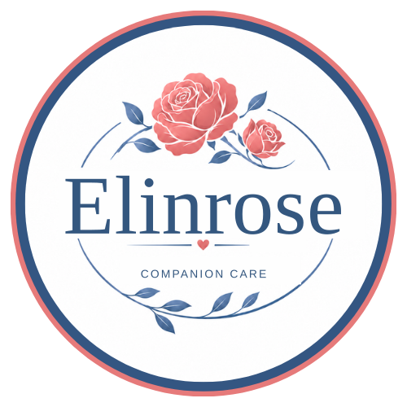

# Elinrose companion care — Fancy's public form reference library

**Status:** Reference set, November 7, 2026  
**Reader:** Whitney, Fancy, and other authorized form designers.  
**Scope:** Publicly readable **blank design templates** and approved business artwork only. Nothing in this repository is a client record.

> **Fancy: Start here.** You do **not** need a Google Drive connection for these public URLs. Open this Markdown page and the exact image/PDF links below with web-reading or browsing tools. Do not claim access to any file until you successfully open it. A pasted link cannot give a chat capabilities it does not have.

## Official Elinrose logo

**Canonical business spelling:** `Elinrose companion care` (one word "Elinrose").  
**Canonical image:** `Elinrose_Companion_Care_Official_Logo.png`. The mark reads **Elinrose / COMPANION CARE**, preserving the roses, heart, foliage, and circular outline. The old `Elin Rose / HOME CARE ASSISTANCE` mark is obsolete. Embed the original image; never redraw it, recolor it, retype it, stretch it, or generate a substitute.

## Reference files — direct public downloads

| File | Purpose | Public direct file |
| --- | --- | --- |
| [`Elinrose_Companion_Care_Official_Logo.png`](./Elinrose_Companion_Care_Official_Logo.png) | Official 500 × 500 brand PNG; preserve original artwork | [Direct Image URL](https://raw.githubusercontent.com/IPXSdev/xa-vault/main/brands/elinrose-companion-care/Elinrose_Companion_Care_Official_Logo.png) |
| [`Elinrose_All_Care_Forms_Fillable.pdf`](./Elinrose_All_Care_Forms_Fillable.pdf) | Complete fillable reference; 4 pages, 159 form fields | [Direct Fillable PDF URL](https://raw.githubusercontent.com/IPXSdev/xa-vault/main/brands/elinrose-companion-care/Elinrose_All_Care_Forms_Fillable.pdf) |
| [`Elinrose_All_Care_Forms_Printable.pdf`](./Elinrose_All_Care_Forms_Printable.pdf) | Complete print version; 4 pages | [Direct Printable PDF URL](https://raw.githubusercontent.com/IPXSdev/xa-vault/main/brands/elinrose-companion-care/Elinrose_All_Care_Forms_Printable.pdf) |
| [`Elinrose_Daily_Activity_Log_Fillable.pdf`](./Elinrose_Daily_Activity_Log_Fillable.pdf) | Daily Care & Activity Log; 1 page, 48 fields | [Direct Fillable PDF URL](https://raw.githubusercontent.com/IPXSdev/xa-vault/main/brands/elinrose-companion-care/Elinrose_Daily_Activity_Log_Fillable.pdf) |
| [`Elinrose_Client_Medication_Log_Fillable.pdf`](./Elinrose_Client_Medication_Log_Fillable.pdf) | Client Medication Log; 1 page, 52 fields | [Direct Fillable PDF URL](https://raw.githubusercontent.com/IPXSdev/xa-vault/main/brands/elinrose-companion-care/Elinrose_Client_Medication_Log_Fillable.pdf) |
| [`Elinrose_Meal_Preparation_Questionnaire_Fillable.pdf`](./Elinrose_Meal_Preparation_Questionnaire_Fillable.pdf) | Meal Preparation Questionnaire; 2 pages, 59 fields | [Direct Fillable PDF URL](https://raw.githubusercontent.com/IPXSdev/xa-vault/main/brands/elinrose-companion-care/Elinrose_Meal_Preparation_Questionnaire_Fillable.pdf) |

**One-link location for Whitney to share with Fancy:**  
`https://github.com/IPXSdev/xa-vault/tree/main/brands/elinrose-companion-care`

**Machine-readable guide (plain Markdown):**  
`https://raw.githubusercontent.com/IPXSdev/xa-vault/main/brands/elinrose-companion-care/README.md`

All PDF source forms in this reference edition contain blank fields, with no real client data. The fillable 4-page packet groups three form types: Daily Care & Activity Log, Client Medication Log, and the 2-page Meal Preparation Questionnaire. The standalone documents are alternatives/views of the same form families, not five new form types.

## Fancy — how to produce new Elinrose forms

1. **Verify sources:** Read this guide, open the logo PNG, and inspect the closest existing PDF. If browsing or PDF reading is unavailable in Whitney's ChatGPT conversation, say that explicitly; ask for an alternate supported method rather than inventing field names or visually approximating the layout.
2. **Clarify the new form:** Identify audience, who completes it, required sections/fields, whether it will be printed or electronically filled, and the responsible approver. Ask when required information is missing. Do not fabricate dates, names, hours, rates, consent language, diagnoses, medication directions, or legal terms.
3. **Respect brand and layout:** Use the actual logo as an embedded image. Match the existing welcoming, legible style: navy headings, restrained coral accents, pale section backgrounds, thin dividers, comfortable whitespace and practical writing space. Keep the proportions and adequate clear space around the logo. Use US Letter (8.5 × 11 inches) when appropriate.
4. **Build the correct form type:** If Whitney requests a fillable PDF, it must have functioning interactive fields with usable names, tab order and appropriate input types. A PDF with printed blank lines is not fillable. Supply a printable variant as well when requested.
5. **Inspect and validate:** Render every page; check logos, page breaks, margins, text clipping, font legibility, contrast and field positions. For digital PDF controls, count them, enter fictional test values, save, reopen, and confirm values persist. State which actual tests were performed and what remains untested.
6. **Approval and release:** Give draft(s) to Whitney or the designated Elinrose approver. Keep these canonical reference files unchanged and version any new approved output. Do not claim legal compliance, HIPAA readiness, clinical authorization, accessibility certification or device support without separate evidence.

## Boundaries, especially for health and caregiving

- The PDFs are **design references**, not permission to administer medications or give medical advice.
- Do not insert real names, medications, addresses, phone numbers, signatures, medical conditions, completed forms, passwords or other private client details into this **public** GitHub repository, public web links or sample files.
- Real completed records must stay in a separately approved, access-controlled care workflow. This public folder is never a record-storage destination.
- No assistant can gain web access, PDF-read support, or long-term memory merely because Whitney pastes a URL. Re-open the public reference as needed when starting a new chat.
- These are approved reference copies, not verified as fully legally, clinically, or accessibility compliant.

## File integrity

The copies were transferred from the established blank-form reference set. GitHub Git blob SHAs (for tracking, not SHA-256):

- `Elinrose_Companion_Care_Official_Logo.png`: `fb0f880bdfb87bc6ddefa39320cedb0e593686da`
- `Elinrose_All_Care_Forms_Fillable.pdf`: `f7c6f72d7cb8c93cf6d6d04ca56bc9b31e4d4266`
- `Elinrose_All_Care_Forms_Printable.pdf`: `2d80cef0f088a63c44e8771712830beb0aebf74d`
- `Elinrose_Daily_Activity_Log_Fillable.pdf`: `5db5c6bdcfa6d9dd54db8dd634fdb2e66d38aba3`
- `Elinrose_Client_Medication_Log_Fillable.pdf`: `16c7482e956ecf334c1ac3aa1a0337d201525693`
- `Elinrose_Meal_Preparation_Questionnaire_Fillable.pdf`: `b5cfdc5d2565e116de30867dd4764117811db8fb`

### Suggested message Whitney can paste into Fancy

> Fancy, here is Elinrose companion care's public reference library: https://github.com/IPXSdev/xa-vault/tree/main/brands/elinrose-companion-care . Read the README and inspect the approved logo and existing blank PDFs before drafting my next form. Use them as the visual and field-structure source of truth. Tell me exactly which files you successfully opened. Do not recreate the logo or claim to have accessed PDFs you could not open.
